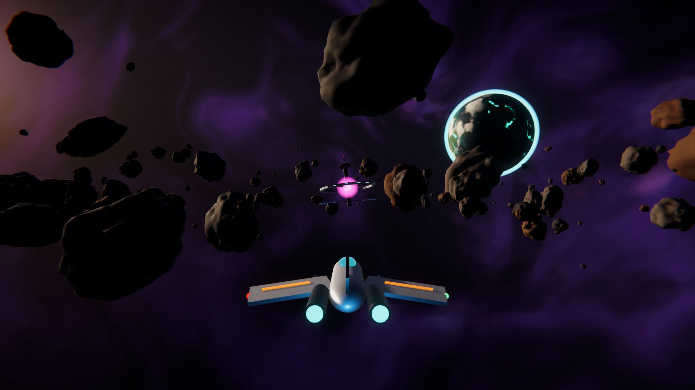

# DRIFTLIGHT

> A single-player 3D space exploration shooter, built in Unity 6.

You're a lone scavenger pilot who picks up a mysterious signal from a dead star system. Every planet in the system once had a thriving civilization, and every one of them vanished on the same day. Warp between planets, fight what is guarding them, upgrade your ship, and follow the signal to its source.

---

## Team

| Member | Main focus | Also works on |
|---|---|---|
| **Miguel Reese** | Ship flight, space combat, warp drive, ship upgrades | Visual effects, gameplay systems |
| **Mark Guggenheim** | Planet surfaces, on-foot exploration, tools, HUD and menus | Level design, story, audio |

We both work across the whole stack: the "backend" (gameplay code, AI, upgrade and save data) and the "frontend" (scenes, UI, effects, anything the player sees). The focus areas above say who owns what, so we can work in parallel without stepping on each other's scenes.

---

## Current target for the game

*This is the target as of the first group review. It will change as we playtest.*

**Genre:** single-player 3D action exploration (space combat + on-foot exploration), with a mystery story.

### Core loop
1. **Warp** to a planet. Your warp drive's range decides which planets you can reach.
2. **Fight** enemy ships in orbit (arcade-style space combat).
3. **Land** and explore the planet surface on foot with your blaster and tools.
4. **Collect** salvage and a **signal fragment**, a piece of the story.
5. **Upgrade** your ship and gear, then warp further into the system.

### Planets
Each planet has its own look, its own mechanic and its own enemies. The target is **5 polished planets**; the rest are stretch goals.

| # | Planet | Look | Unique mechanic | Enemies |
|---|---|---|---|---|
| 1 | **Verdance** | Glowing alien jungle | Tutorial planet | Spore drones |
| 2 | **Cinder** | Lava fields, ash skies | Eruptions to dodge | Magma crawlers |
| 3 | **Glacius** | Ice caves, auroras | Slippery ground, cold meter | Ice stalkers |
| 4 | **Mirage** | Desert ruins | Sandstorms that hide enemies | Sand wraiths |
| 5 | **Abyssa** | Ocean world, floating islands | Jetpack between islands | Sky eels |
| 6 | *Prism* (stretch) | Crystal planet | Light-refraction puzzles | Crystal sentinels |
| 7 | *Hollow* (stretch) | Dead moon, ship graveyard | Flashlight-only horror level | Hijacked ship AI |
| 8 | **The Source** | Final planet | Boss fight and the story reveal | ??? |

### Upgrades
- **Ship:** hull, shields, weapons (blasters → missiles → charge beam), boost, **warp range** (unlocks new planets)
- **Tools:** blaster upgrades, **scanner** (reveals clues and weak points), **grapple**, **jetpack**
- **Currency:** salvage from destroyed enemies and planet surfaces

### The mystery
Every planet holds one signal fragment. Each fragment is a short log from the people who vanished, and together they explain what happened on the day everyone disappeared, and why the signal is calling *you*.

---

## Goals for each member

### Miguel Reese
- Arcade ship flight model and chase camera
- Ship weapons, enemy ship AI and combat encounters in orbit
- Warp drive: charge-up, warp tunnel effect, travel between planets
- Ship upgrade system (hull, shields, weapons, warp range)
- Space visuals: skyboxes, explosions, engine trails, warp streaks

### Mark Guggenheim
- First-person on-foot controller for planet surfaces
- Planet surfaces and level design: Verdance first, then Cinder, Glacius, Mirage and Abyssa
- Tools: scanner, grapple, jetpack
- HUD, menus, upgrade shop UI, save and load
- Story: signal fragments, lore logs and the final reveal

### Both of us
- Playtesting and balancing
- Sound effects and music
- The gameplay video and final polish

---

## Gameplay video

*Coming soon. The link to our current gameplay video will go here.*

---

## Progress

- [x] Repo, Unity `.gitignore` and README
- [x] Unity 6 project (URP)
- [x] Ship flight and chase camera
- [x] Space combat: blasters, enemy drones, waves, HUD
- [x] Warp drive and the first planet (Verdance)
- [ ] Upgrade shop
- [ ] Planets 2–5
- [ ] Final planet, boss and story reveal

## Roadmap

| Milestone | Goal |
|---|---|
| **Group review (now)** | Fly the ship, fight enemy drones, warp to Verdance and walk around |
| **Milestone 2** | 2 planets, salvage and the upgrade shop, basic menus |
| **Milestone 3** | 5 planets, full story, boss fight |
| **Final** | Polish: audio, effects, menus, balancing; stretch planets if there is time |

---

## Getting started

1. Install **Unity 6000.6.2f1** (Unity 6) through Unity Hub.
2. Clone the repo:
   ```bash
   git clone https://github.com/miguelr-dev/driftlight.git
   ```
3. In Unity Hub choose **Add → Add project from disk** and pick the `driftlight` folder.
4. Open `Assets/Scenes/Space.unity` and press **Play**. Click the Game view to capture the mouse; **Esc** frees it.

### Controls

| Ship | |
|---|---|
| Mouse | Steer (the small diamond shows how hard you're turning) |
| Left click | Fire blasters |
| W / S | Thrust / brake |
| A / D | Strafe |
| Q / E | Roll |
| Space / Ctrl | Up / down |
| Shift | Boost |
| Hold F | Warp (unlocks once the relay is clear) |

| On foot | |
|---|---|
| Mouse | Look |
| W A S D | Move |
| Shift | Sprint |
| Space | Jump |
| E | Interact (recover signal fragments) |

### Screenshots

| The Drift | Verdance |
|---|---|
|  |  |

### Scene builder

The scenes, materials, textures and meshes in `Assets/Driftlight/Generated` and `Assets/Scenes` are generated from code by the **DRIFTLIGHT** menu in Unity (`Assets/Driftlight/Editor/DriftlightBuilder*.cs`): procedural skyboxes, planet textures, asteroids and the relay station. **Rebuilding a scene overwrites it**, so once someone starts hand-editing a scene, stop rebuilding that one.

## How we work

- Nothing is committed straight to `main`. Every change goes on its own branch (`feature/…`, `docs/…`, `setup/…`) and is merged through a pull request.
- Unity's generated folders (`Library/`, `Temp/`, `Logs/`, `UserSettings/`, builds) are kept out of git by `.gitignore`. Only `Assets/`, `Packages/` and `ProjectSettings/` are committed.
- Each of us owns different scenes, so we don't hit merge conflicts in scene files.
