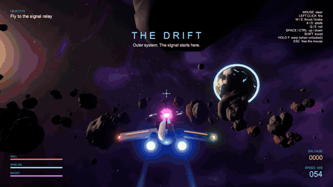
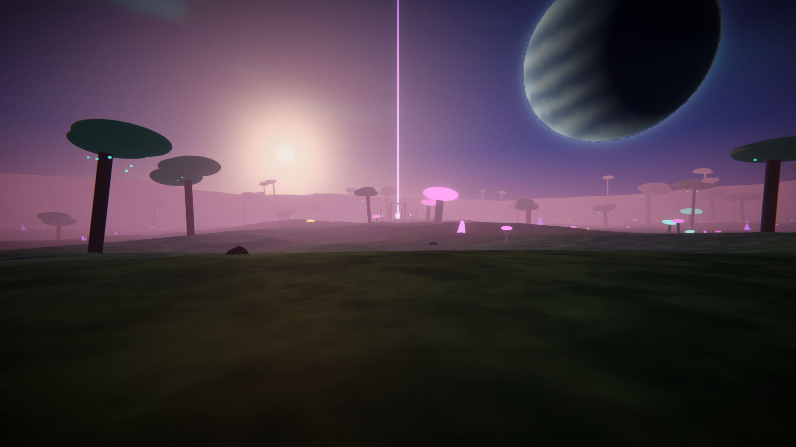

# DRIFTLIGHT

> A single-player 3D space exploration shooter, built in Unity 6.

You're a lone scavenger pilot who picks up a mysterious signal from a dead star system. Every planet in the system once had a thriving civilization, and every one of them vanished on the same day. Fight your way past what guards it, explore two strange worlds on foot, upgrade your ship, and follow the signal to its source.

---

## Team

| Member | Main focus | Also works on |
|---|---|---|
| **Miguel Reese** | Ship flight, space combat, warp drive, ship upgrades | Visual effects, gameplay systems |
| **Mark Guggenheim** | Planet surfaces, on-foot exploration, tools, HUD and menus | Level design, story, audio |

We both work across the whole stack: the "backend" (gameplay code, AI, upgrade and save data) and the "frontend" (scenes, UI, effects, anything the player sees). The focus areas above say who owns what, so we can work in parallel without stepping on each other's scenes.

---

## Current target for the game

*Target as of the first group review: a tight, polished game of **about 10 minutes**. It will change as we playtest.*

**Genre:** single-player 3D action exploration (space combat + on-foot exploration), with a mystery story.

### The run (about 10 minutes)

| # | Stop | What happens | Time |
|---|---|---|---|
| 1 | **The Drift** | Space fight at the derelict signal relay, then warp | ~2 min |
| 2 | **Verdance** | Glowing jungle at dusk. Learn the **scanner**, follow the beam, recover signal fragment 1 | ~3 min |
| 3 | **Cinder** | Lava fields and eruptions. Use the **jetpack** to cross the lava to fragment 2 | ~3 min |
| 4 | **The Source** | Short boss fight, fragment 3 and the story reveal | ~2 min |

Between planets you **pick 1 of 3 upgrades** (shields, fire rate or boost), paid for with the salvage you collected.

### Core loop
1. **Fight** enemy ships in space (arcade-style combat).
2. **Warp** to the next planet.
3. **Explore** the surface on foot with your tools.
4. **Recover** the planet's signal fragment, a piece of the story.
5. **Upgrade**, then warp deeper into the system.

### The mystery
There are three signal fragments, one on each stop. Each is a short log from the people who vanished, and together they explain what happened on the day everyone disappeared, and why the signal is calling *you*.

### Cut for time
Glacius, Mirage, Abyssa, Prism and Hollow, the grapple, and a full upgrade shop. We'll only bring one back if the 10-minute version is finished and polished.

---

## Goals for each member

### Miguel Reese
- Ship flight, chase camera and space combat (done for the first fight)
- Warp drive and travel between stops
- Verdance and The Source, including the boss fight
- Hooking the upgrade picker into the ship's stats
- Space visuals: skyboxes, explosions, engine trails, warp streaks

### Mark Guggenheim
- UI style and mockups (done, see `docs/mockups`)
- Main menu and the upgrade picker screen
- Cinder: level design, lava hazards and eruptions
- Story: the three signal-fragment logs and the final reveal (`docs/STORY.md`)
- Tools on foot: scanner and jetpack

### Both of us
- Playtesting and balancing
- Sound effects and music
- The gameplay video and final polish

---

## Gameplay video

**[▶ Watch the 25-second gameplay clip (MP4)](docs/media/gameplay.mp4)**: flying through The Drift, the fight at the signal relay, and landing on Verdance.



*Recorded from a real build with the game's autoplay mode (`-autoplay -capture`), so it shows actual gameplay, not edited footage.*

---

## Progress

- [x] Repo, Unity `.gitignore` and README
- [x] Unity 6 project (URP)
- [x] UI style and mockups
- [x] Ship flight and chase camera
- [x] Space combat: blasters, enemy drones, waves, HUD
- [x] Warp drive and the first planet (Verdance)
- [ ] Main menu
- [x] Story bible and fragment logs (`docs/STORY.md`)
- [ ] Cinder
- [ ] Upgrade picker
- [ ] Scanner and jetpack
- [ ] The Source: boss fight and reveal

## Roadmap

| Milestone | Goal |
|---|---|
| **Group review (now)** | Fly the ship, fight enemy drones, warp to Verdance, recover fragment 1 |
| **Milestone 2** | Main menu, Cinder, the upgrade picker, the full story |
| **Milestone 3** | The Source and the boss; the whole 10-minute run playable start to finish |
| **Final** | Polish: audio, effects, balancing, the gameplay video |

---

## Getting started

1. Install **Unity 6000.6.2f1** (Unity 6) through Unity Hub.
2. Clone the repo:
   ```bash
   git clone https://github.com/miguelr-dev/driftlight.git
   ```
3. In Unity Hub choose **Add → Add project from disk** and pick the `driftlight` folder.
4. Open `Assets/Scenes/Space.unity` and press **Play**. Click the Game view to capture the mouse; **Esc** frees it.

### Controls

| Ship | |
|---|---|
| Mouse | Steer (the small diamond shows how hard you're turning) |
| Left click | Fire blasters |
| W / S | Thrust / brake |
| A / D | Strafe |
| Q / E | Roll |
| Space / Ctrl | Up / down |
| Shift | Boost |
| Hold F | Warp (unlocks once the relay is clear) |

| On foot | |
|---|---|
| Mouse | Look |
| W A S D | Move |
| Shift | Sprint |
| Space | Jump |
| E | Interact (recover signal fragments) |

### Screenshots

| The Drift | Verdance |
|---|---|
|  |  |

### Scene builder

The scenes, materials, textures and meshes in `Assets/Driftlight/Generated` and `Assets/Scenes` are generated from code by the **DRIFTLIGHT** menu in Unity (`Assets/Driftlight/Editor/DriftlightBuilder*.cs`): procedural skyboxes, planet textures, asteroids and the relay station. **Rebuilding a scene overwrites it**, so once someone starts hand-editing a scene, stop rebuilding that one.

## How we work

- Nothing is committed straight to `main`. Every change goes on its own branch (`feature/…`, `docs/…`, `setup/…`) and is merged through a pull request.
- Unity's generated folders (`Library/`, `Temp/`, `Logs/`, `UserSettings/`, builds) are kept out of git by `.gitignore`. Only `Assets/`, `Packages/` and `ProjectSettings/` are committed.
- Each of us owns different scenes, so we don't hit merge conflicts in scene files.
