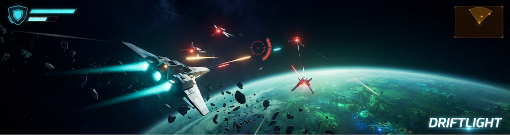
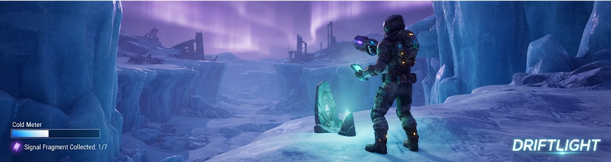

# Art direction

How DRIFTLIGHT should look, and how to get there **simply** in Unity. The rule: dark scenes, a few bright glowing things, and coloured fog do most of the work. No detailed models needed.

## Concept art

What to take from these:

- **Dark backgrounds, bright accents.** Engines, enemy eyes, the fragment and the aurora glow; everything else stays dark or soft.
- **One mood per planet.** Verdance is green and teal, Glacius is ice blue under a violet aurora.
- **Ruins everywhere.** Broken structures in the distance say "people lived here" without any story text.
- **Minimal HUD.** Small glowing bars in the corners, no big boxes.
- **Logo:** bold italic white `DRIFTLIGHT` with a cyan light streak under it.

## The simple recipe in Unity

| Need | Do this |
|---|---|
| Glow | URP **Bloom** on a global Volume. Give engines, eyes, crystals and lava a bright **emission** colour. Bloom does the rest. |
| Mood | One **fog** colour and one **directional light** colour per planet (Lighting window). This sets 80% of the look. |
| Sky | A space skybox for orbit; a gradient skybox per planet. |
| Shapes | Unity primitives and **ProBuilder** (cubes, cylinders, stretched and rotated). Free low-poly packs like Kenney's Space Kit or Quaternius (CC0) for ships and props. |
| Effects | **Trail Renderer** for engine trails, **Particle System** for snow, ash, sparks and asteroids. |
| HUD | Unity UI with **TextMeshPro** and the **Exo 2** font (free, Google Fonts). |

Post-processing to start with: Bloom (threshold ~0.9, intensity ~1), Tonemapping ACES, a light Vignette. That's it.

## Colours

| Colour | Hex | Means |
|---|---|---|
| Cyan | `#5fe3ff` | You: shields, your bars, crosshair, selection |
| Red | `#ff4d5e` | Enemies, lock-on, hull damage |
| Amber | `#ffb347` | Radar, salvage, upgrades |
| Violet | `#b77cff` | The signal and signal fragments |

Each planet's own colours are on the [planet looks page](mockups/planets.html).

## Decisions

- **On-foot camera:** the concept art is third person. We start in **first person**, because there's no character to model or animate. Third person (Unity's free Starter Assets) can come later.
- **Fragments:** the counter reads **x/7**. One fragment on each planet before The Source, which is where the story ends.
- **Same HUD corners everywhere:** shield top left, radar top right, the planet's meter and the fragment count bottom left.

## Mockups

- [HUD and menus](mockups/hud.html): ship HUD, on-foot HUD, main menu, upgrade shop, star map
- [Planet looks](mockups/planets.html): one card per planet with colours, how to build it, and its HUD meter
