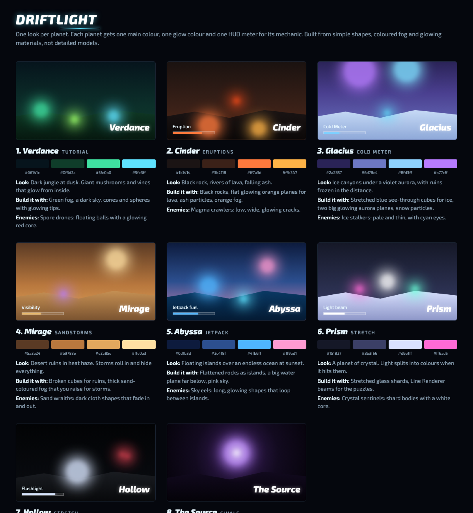

# Mockups

Quick visual mockups so the game has one shared style before we build it in Unity. Open the HTML files in a browser for full size. The style rules and concept art are in [`../art-direction.md`](../art-direction.md).

## HUD and menus: [`hud.html`](hud.html)

1. **Ship HUD:** shield icon and bars top left, amber radar top right, red lock-on in the middle. The ship side is Miguel's call; it's here so both HUDs match.
2. **On-foot HUD:** same corners, plus the planet's meter (cold on Glacius), the fragment counter and the tool bar.
3. **Main menu**, 4. **Upgrade shop**, 5. **Star map** (the dashed circle is your warp range).

## Planet looks: [`planets.html`](planets.html)

One card per planet: its colours, what it looks like, how to build it simply, and its HUD meter.

These are mockups, not final art. They'll change once we build and playtest.
