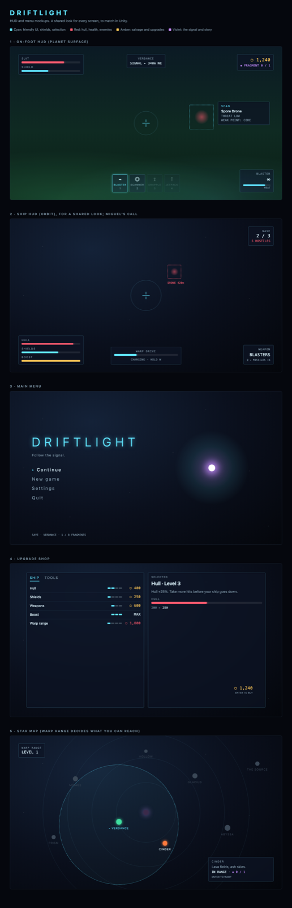

# HUD and menu mockups

First pass at how DRIFTLIGHT's screens could look, so the UI has one shared style before we build it in Unity. Open [`hud.html`](hud.html) in a browser for the full-size version.

## Screens

1. **On-foot HUD:** suit and shield bars, salvage and fragment count, signal direction, scanner readout, tool bar (blaster, scanner, grapple, jetpack) and blaster heat.
2. **Ship HUD:** hull, shields, boost, warp charge, current weapon and wave count. Only here so both HUDs match; the ship side is Miguel's call.
3. **Main menu:** title, menu and the save summary.
4. **Upgrade shop:** ship and tools tabs, upgrade levels, salvage costs and what an upgrade changes.
5. **Star map:** the 8 planets on their orbits. The dashed circle is your warp range; planets outside it are locked.

## Style

| Colour | Hex | Used for |
|---|---|---|
| Cyan | `#5fe3ff` | Friendly UI, shields, selection, crosshair |
| Red | `#ff5a6e` | Hull, health, enemies, can't afford |
| Amber | `#ffc857` | Salvage and upgrades |
| Violet | `#c58bff` | The signal and story fragments |
| Panel | `#0c1424` at 72% opacity | HUD panels, with a thin cyan border |

- **Fonts:** a clean sans for names and descriptions, and a monospace for numbers and readouts.
- **Labels:** small, uppercase and widely spaced.
- **Layout:** status at the top, health on the left, tools and weapon at the bottom, so it's easy to read at a glance.

These are mockups, not final art. They will change once we build them and playtest.
